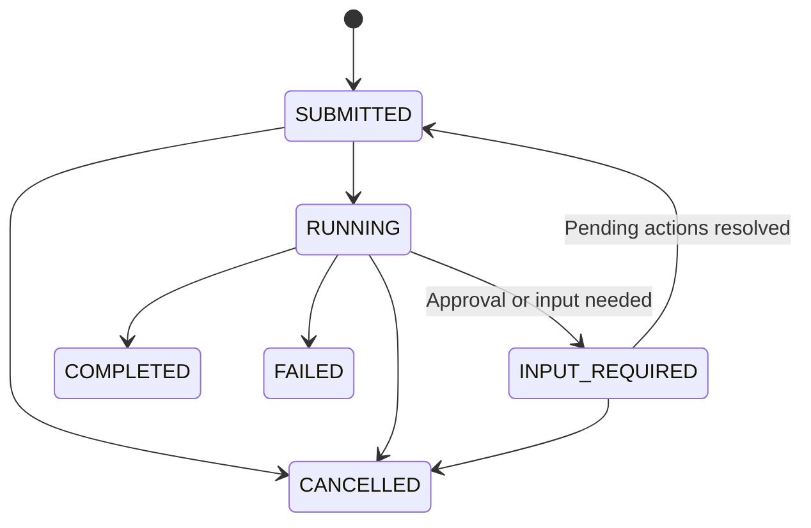

# Agent Runs, Persistence, and Streaming

`RunAgent` submits a durable unit of work associated with a room. Run records, room messages, pending actions, and live events are separate data structures with different lifetimes.

## Submit and inspect a run

Run these templates in an authenticated SEMOSS context, replacing the identifiers:

```pixel
RunAgent(
    roomId=["<room-id>"],
    command=["Summarize the files in this workspace."],
    engine=["<model-engine-id>"],
    workspaceId=["<workspace-id>"],
    harnessType=["semoss"],
    maxTurns=[10],
    wait=[false]
);
```

The asynchronous result has this shape:

```json
{
  "runId": "<run-id>",
  "roomId": "<room-id>",
  "status": "SUBMITTED"
}
```

Use the returned run ID rather than a Pixel job ID to monitor the agent:

```pixel
GetAgentRun(runId=["<run-id>"], includeMessages=[true]);
GetAgentRunsForRoom(roomId=["<room-id>"]);
```

`GetAgentRun` returns durable status, output, message IDs, errors, and pending actions. `includeMessages` adds the run's room-message projection. The owning user is checked when accessing run records.

An agent's Activity tab lists the user's own rooms with it:

```pixel
GetAgentRunRooms(agentId=["<workspace-id>"], search=["report"], status=["RUNNING"], limit=[25], offset=[0]);
GetAllAgentRunsForRoom(roomId=["<room-id>"]);
```

`GetAgentRunRooms` returns `rooms` and `total` in the shape `AdminGetAgentRunRooms` uses (see Admin review), read only from the caller's runs by the id and login type of their primary login. A room where the agent ran only as another agent's subagent is listed too. `GetAllAgentRunsForRoom` returns every run the caller has in an opened room, newest first, subagent runs included, each with the room's `roomName` and `isRoomClosed`. `GetAgentRunsForRoom` returns only the room's root runs, oldest first, for playing a conversation back.

### Submission parameters

| Key | Behavior |
| --- | --- |
| `roomId`, `command` | Required room and user task |
| `engine` | Explicit model selection; otherwise resolve from room/workspace configuration |
| `workspaceId` | Agent configuration for this run |
| `harnessType` | Default `semoss`; explicit unknown names fail before persistence |
| `space` | File target; see [agent configuration](agent_configuration.md) |
| `maxTurns`, `maxReflections` | Native-loop limits, subject to workspace caps |
| `paramValues` | Model parameters and supported runtime options such as `max_seconds` and `subdir` |
| `agentParams` | Agent-specific parameters available to configuration/hooks |
| `media` / `image`, `url` | Initial media inputs, only when supported by the selected harness |
| `wait` | Defaults to `true`; `false` returns a submission handle |
| `waitTimeoutMs` | Waiting deadline; zero/omitted uses the server setting |

Synchronous waiting returns when the run completes, fails, is cancelled, reaches `INPUT_REQUIRED`, or the wait times out. A timeout returns the current snapshot; it does not cancel the run. Browser clients should generally submit asynchronously and monitor progress.

## Lifecycle



| Status | Meaning |
| --- | --- |
| `SUBMITTED` | Persisted and waiting for an eligible execution turn |
| `RUNNING` | Claimed by a worker |
| `INPUT_REQUIRED` | Paused on persisted pending actions; execution can resume |
| `COMPLETED` | Final result recorded |
| `FAILED` | Execution failed; inspect the recorded error |
| `CANCELLED` | Cancellation recorded |

`INPUT_REQUIRED` ends a synchronous wait but is not a completed task. The same run can be re-submitted internally for continuation after decisions are recorded.

[AgentRunQueueLoop](../../src/prerna/reactor/agent/run/AgentRunQueueLoop.java) starts the oldest eligible submitted turn for a room. Admission combines an in-process room claim, an optional Redis lease, and an atomic durable status update. [AgentRunExecutor](../../src/prerna/reactor/agent/run/AgentRunExecutor.java) classifies the harness result and records the outcome.

## Approval and input pauses

A tool marked `SMSS_MCP_EXECUTION=ask` creates an approval boundary. The harness records pending actions in `AGENT_RUN_ACTION`; each action carries its run, room, tool call, arguments, metadata, decision state, and result.

1. The run becomes `INPUT_REQUIRED` and returns pending action information.
2. The client can read a specific action with `GetAgentRunAction(actionId=["<action-id>"])`.
3. The decision path through [RunMCPToolReactor](../../src/prerna/reactor/agent/mcp/RunMCPToolReactor.java) and [AgentToolDecisionHandler](../../src/prerna/reactor/agent/mcp/AgentToolDecisionHandler.java) validates the persisted action and caller.
4. `approve` and `edit` execute the authorized tool. `reject` and `respond` record the supplied decision/result without executing that tool.
5. Once the pending batch is decided, the worker resumes the native harness from the tool results. It owns the subsequent model call.

Already-decided actions have replay handling. Clients should use the persisted action IDs and the current decision API rather than fabricate tool results or submit another copy of the user's task.

## Live event polling

Monolith exposes:

```text
POST /Monolith/api/engine/agentRunStreaming
Content-Type: application/x-www-form-urlencoded

runId=<run-id>
```

Use the session and CSRF handling required by the deployment. This endpoint returns JSON; it is a polling endpoint, not an SSE subscription. The response shape is:

```json
{
  "run": { "runId": "<run-id>", "status": "RUNNING" },
  "events": [],
  "droppedEvents": 0
}
```

The `run` object is the authorized durable snapshot. `events` contains buffered `item.started`, `item.updated`, and `item.completed` events for message, reasoning, tool, and subagent items. Fields depend on the item kind and provider support.

[AgentRunStreamService](../../src/prerna/reactor/agent/stream/AgentRunStreamService.java) currently retains up to 2,000 events per run. Polling **drains** the events, so the stream assumes a single consumer. Terminal buffers expire after a grace period, currently 60 seconds. Overflow increments `droppedEvents`; rebuild the display from the durable snapshot/messages when deltas are missing.

Canonical stream sessions currently cover `semoss` and `claude_code`. Other harnesses can have durable run status without these events. Do not use `/pixelJobStreaming` as the agent event feed.

## Cancellation

```pixel
StopAgentRun(runId=["<run-id>"]);
```

Cancellation records the durable state and signals active execution. Interruption and cancellation checks cooperate with the harness and tools; cancellation cannot undo external effects already performed. A client that stops polling has not cancelled the run.

A cancelled run keeps what it recorded. The native harness writes the room's messages as each model reply and tool result arrives, so they last to the final finished step; only the step in flight is lost. Its progress snapshot (`PROGRESS_JSON`) is written once more as it stops, and a Claude Code run's JSONL transcript is whatever the CLI wrote. The reason and time the canceller records (`ERROR_MESSAGE`, `COMPLETED_AT`) are kept, and a cancel is final: a cancelled run is never recorded as completed or failed afterwards, even when it fails as the interrupt unwinds it. When its thread finishes anyway, such as after a cancel from another server it never saw, the run stays cancelled with the canceller's reason and time, and its parent's live view gets the cancel; the final text it reached is kept in `FINAL_OUTPUT`, beside the messages already in the room. In a cluster the room folder, the transcript with it, is pushed to cloud storage however the run ended.

## Durability and cluster behavior

| State | Authoritative location |
| --- | --- |
| Run request, status, final output, and progress | `AGENT_RUN` in the model-inference database |
| Pending tool decisions | `AGENT_RUN_ACTION` in the same database |
| Conversation projection | `ROOM.MESSAGES`, accessed through `RoomMessageStore` |
| Working files and skill copies | Resolved room/user/project assets, with configured cloud synchronization |
| Live deltas | Memory of the application node producing them |
| Live credentials and execution context | The submitting node's `InsightHandle` |

The Redis room turn lease is controlled by `AGENT_RUN_QUEUE_ENABLED` and requires Redis to be enabled. Its default follows Redis availability. `AGENT_RUN_ACTIVE_TTL_MS` controls the renewable lease lifetime. ZooKeeper asset synchronization is a different feature and does not supply this lease.

Ordinary submissions are node-affine because live user tokens are not persisted. Some server-owned continuation and child-completion paths can reconstruct context after restart; this is not a general guarantee that arbitrary active user runs resume on another node. Routing must also account for node-local HTTP/session state and live event buffers.

## Admin review

Admins read every user's runs from the Agent Runs page in admin settings. Each reactor below refuses anyone who is not an admin. All but `AdminCloseRoom` only read:

```pixel
AdminGetAgentRunRooms(agentId=["<workspace-id>"], userId=["<user-id>"], userType=["NATIVE"], search=["report"], status=["RUNNING", "FAILED"], limit=[25], offset=[0]);
AdminGetAgentRunAgents(search=["builder"], limit=[25]);
AdminGetAgentRunUsers(search=["alice"], limit=[25]);
AdminGetAllAgentRunsForRoom(roomId=["<room-id>"], userId=["<user-id>"], userType=["NATIVE"]);
AdminGetAgentRun(runId=["<run-id>"], includeMessages=[true]);
AdminGetSubagentRuns(runId=["<run-id>"]);
AdminGetClaudeCodeTranscriptHistory(roomId=["<room-id>"]);
AdminCloseRoom(roomId=["<room-id>"], userId=["<user-id>"], userType=["NATIVE"]);
```

`AdminGetAgentRunRooms` returns `rooms` and `total`. It lists one row per room and user, most recently active first, with the user's name, email and login type, the agent's name, `runCount`, `activeRunCount`, `failedRunCount`, `isClosed`, `firstRunAt` and `lastActivityAt`. Every filter is optional: `agentId` lists rooms holding a run of that agent, `userId` with `userType` that user's rooms, `search` rooms whose name or id contains the text in any case, and `status` rooms holding a run in any of the given statuses.

`AdminGetAgentRunAgents` and `AdminGetAgentRunUsers` give the page's agent and user filters their choices: the agents and users of the listed rooms, most recently active first, up to `limit` (25 by default, at most 100). An agent comes with its name; a user is an id and login type with their name and email, and a user whose runs store no login type is offered under the login their id has. `search` matches an agent's name or id, or a user's name, username, email or id, in any case. A room that holds only subagent runs is not listed, since it shows nested in its parent's room.

Each run stores its owner as `USER_ID` and `USER_TYPE`, the id and login type of the primary login that submitted it, so the same id under two logins is two users. A room's `userType` is the one its runs store, and its name and email come from that login's `SMSS_USER` row. A run with no `USER_TYPE` matches its id under any login type: its room takes the first `SMSS_USER` login with that id, and `userType` filters and `AdminGetAllAgentRunsForRoom` include it.

The other four return what the room's owner sees on the agent's Activity tab, without the owner check. Each run also carries `modelName`, since an admin may not be able to read the model's metadata. The reactors and `AdminAgentRunReadService` live in `prerna.reactor.agent.admin`. Each reactor reads through `AdminAgentRunReadService.getInstance(user)`, which refuses anyone who is not an admin, so none of its reads runs without that check. The read service is the one agent class that reads the security database, for each room's user, and `SystemEngineRegistry` allows that only from this package. The run-level queries are the `...ForAdmin` methods of `AgentRunStore` and `AgentRunService` in `prerna.reactor.agent.run`, which read the model inference logs database and never the security database. Each takes an `AdminAccess`, the pass only `AdminAccess.of(user)` hands out after the same admin check, and refuses a call without one, so another user's runs are never read without it. The read service holds the pass `getInstance` got. The queries stay in the run package because only it may read `AGENT_RUN` from the model inference logs database. The owner's own reads take the caller's `Insight` and match the id and login type of its primary login (`getRoomsForAgent`, `getRunsForRoomByLogin`).

### Closing a room

`AdminCloseRoom` closes a user's room so that no agent runs in it again; `CloseRoom(roomId=["<room-id>"])` does the same for one of the caller's own rooms, from the agent's Activity tab, matching only the caller's runs and rooms by the id and login type of their primary login. It covers the room, every room its subagent runs use, and the runs in each, continuations a subagent's result started included. It cancels every run in them that has not finished, the deepest first, as a stop would: the run's thread is interrupted, its room lease freed, its subagents and CLI sidecar stopped, its pending approvals and requests to people cancelled. Then it closes the rooms (`ROOM.IS_ACTIVE` false, as a guardrail closing a room or the user removing it leaves it) and clears their Redis copies, and cancels any run that started meanwhile. Runs are cancelled before the rooms close because a model call in a closed room fails, which would record the run as failed. It returns `closedRoomIds`, the rooms that now read as closed (a subagent's room with no messages yet has no row to close), and `cancelledRunIds`. The user no longer sees the rooms in their conversations.

A closed room stays closed for agent runs on every path: `RunAgent` refuses a run in it (`Room is closed`), the worker cancels a queued run whose room closed while it waited, and a subagent result delivered to a closed room starts no follow-up run.

Each admin close records `AGENT_ROOM_CLOSE` in the audit trail at `HIGH` severity (a user closing their own room records none, as stopping their own run records none): the room's user is the subject, the agent the target, the room in the context, and the rooms closed and runs cancelled in `details`. It shows on the admin Audit Trail, not on the agent's Audit tab. Viewing rooms records nothing. `AgentRunService.closeRoomForAdmin` takes the user closing the room, refuses one who is not an admin before reading anything, and records the event itself once the room is closed, so no caller closes another user's room unchecked or unrecorded.

## Troubleshooting

| Symptom | Check |
| --- | --- |
| Agent or room persistence is unavailable | Model-inference database initialization and `MODEL_INFERENCE_LOGS_ENABLED` |
| Run stays `SUBMITTED` | Earlier room turns, active room ownership, Redis lease configuration, and availability of the submitting execution context |
| Run stays `INPUT_REQUIRED` | Pending actions; all decisions in the batch must be settled before continuation |
| Polling has no events | Harness support, polling node, a second consumer, buffer expiration, and the durable run status |
| UI missed part of the output | `droppedEvents` and the durable message projection |
| Model selection fails | Model access, model type/capability, room model, and workspace default |
| Agent finishes without expected files | Tool results and the resolved target; a final text claim alone is not evidence of a write |

See [AgentRunService](../../src/prerna/reactor/agent/run/AgentRunService.java), [AgentRunStore](../../src/prerna/reactor/agent/run/AgentRunStore.java), [RoomMessageStore](../../src/prerna/engine/impl/model/RoomMessageStore.java), and [Monolith's NameServer](https://github.com/SEMOSS/Monolith/blob/dev/src/prerna/semoss/web/services/local/NameServer.java) for the implementation.
