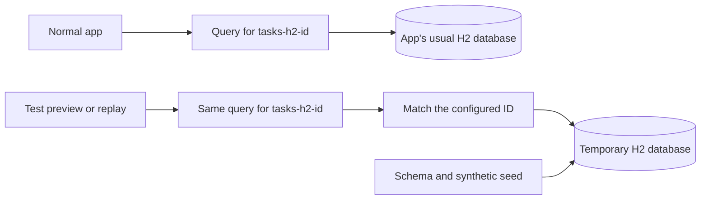
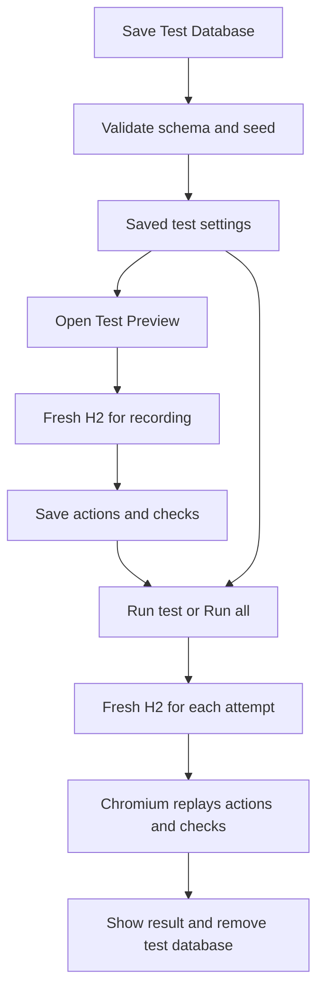

# How isolated H2 app testing works

In **Testing → Test Database**, you tell SEMOSS which H2 engine the app uses and give it SQL to set up a fresh test database. When you open the test preview or replay a recording with the fixture enabled, supported app queries go to that temporary database. Tomcat serves the preview and launches Chromium for replay.

## Why the app’s database ID matters

Imagine the Tasks app sends a query using the engine ID `tasks-h2-id`. Enter that same ID in **Source H2 Database ID**. SEMOSS checks that the engine is H2 and that you can view it. During testing, the ID tells SEMOSS which queries to redirect. The schema creates the tables and the synthetic seed supplies the starting rows.

Queries for a different engine or unsupported operations return an error in the test environment.

## From setup to replay

1. Open **Testing → Test Database** and enable **Use Isolated H2 for Tests**. Enter the app’s H2 engine ID, the schema SQL, and optional seed SQL. **Save Test Database** tries the SQL on a temporary database before saving the settings.
2. Select **Open Test Preview**. SEMOSS takes a snapshot of the current built app and opens it with a fresh H2 database. Record your actions and checks here. **Reset Test Preview** starts again from the seed. **Return to Normal App** closes the test preview.
3. Select **Run test** or **Run all**. Each test and each repeat starts with its own fresh database. The runner performs the saved actions and checks in Chromium, saves the result in Testing history, and removes the temporary database when the attempt ends.

For example, seed a task called `Pending`, record clicking **Mark Done**, and add a check for `Done`. The replay starts at `Pending` even if you already changed the task while recording. Look for **Isolated H2** in the result.

If the test database setting is disabled, ordinary replay uses the published app and its usual database. The Testing buttons use the current build and saved recordings. For assistant changes, the app owner can [enable candidate branches](app-test-database.md#test-changes-from-the-app-building-agent-on-a-candidate-branch). SEMOSS then tests the exact candidate commit against the approved recordings and H2 fixture. Publication is a separate step.

See the [full setup and troubleshooting guide](app-test-database.md) for sample SQL and supported queries.
