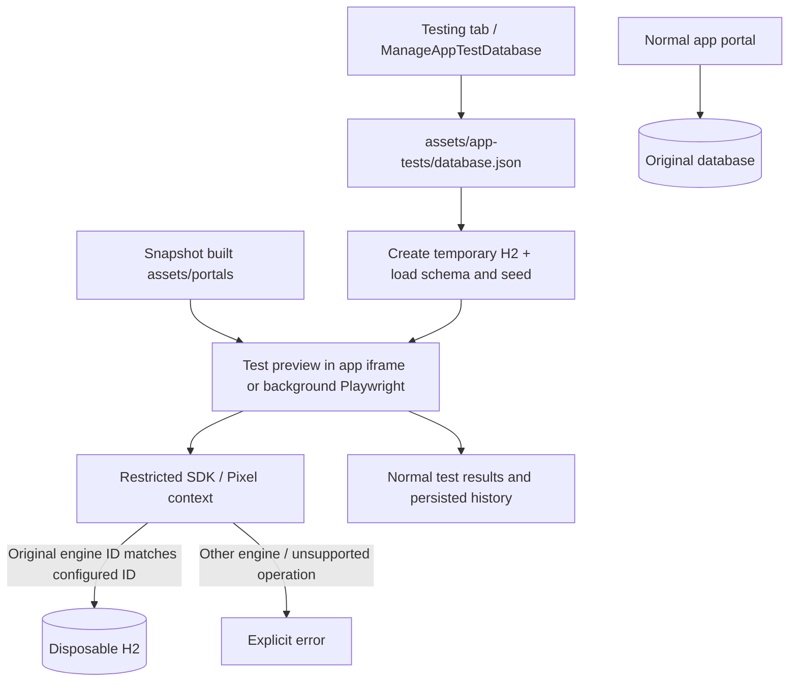

# App regression test databases

This initial version adds an optional H2 fixture to existing app regression testing. Configure it in the Testing tab; no JVM properties, approval files, new database IDs in app code, or CI changes are required.

## Try it

1. Build the app into `assets/portals/index.html`, with relative asset paths. Bundle dependencies, or use the platform-provided core SDK import map. Normal tests still use the published portal; isolated tests snapshot the current built portal files.
2. Open **Testing > Test Database**. Enable **Use Isolated H2 for Tests** and enter the H2 engine ID already used by the app, schema SQL and optional synthetic seed SQL. You need app edit and source engine view access. The source engine is checked through security metadata; no source rows are copied or changed.
3. Click **Save Test Database**. The server validates schema/seed by constructing and disposing a temporary database before saving settings.
4. Click **Open Test Preview**. The same app iframe now uses a disposable database. Record actions and checks normally. **Reset Test Preview** starts again from the seed without loading the normal app in between; **Return to Normal App** closes the preview and restores the original app.
5. Run a selected test, Run All, or ask the app agent to run relevant saved tests. Enabled fixtures are used automatically. Each test and repeated attempt gets a fresh database; changes made during manual recording are not replay prerequisites.
6. Confirm the result says **Isolated H2**. Results and counts use the normal persisted history under `assets/app-tests/test-runs/`.

Example fixture (adapt table/column names to the app):

```sql
-- Schema SQL
CREATE TABLE TASKS (ID VARCHAR(40) PRIMARY KEY, TITLE VARCHAR(200), LANE VARCHAR(40));
```

```sql
-- Synthetic seed SQL: one INSERT per row
INSERT INTO TASKS (ID, TITLE, LANE) VALUES ('t1', 'Test task', 'Ready');
INSERT INTO TASKS (ID, TITLE, LANE) VALUES ('t2', 'Another test task', 'Backlog');
```

The schema must reproduce the tables the app needs. This release does not extract or clone a source database automatically. The agent can prepare the fixture through `ManageAppTestDatabase` using the app's known schema and expected test data.

## Implementation



- `AppTestEnvironment` owns fixture validation, immutable portal snapshots, expiring preview capabilities and H2 cleanup. Settings contain no runtime passwords or connection URLs.
- `AppTestPreviewServlet` serves manual previews and their restricted SDK endpoint. SDK imports use the same public URL as ordinary published portals. The servlet does not inspect frontend deployment directories, copy SDK files or cache their availability at startup. Its capability authorizes only that preview, never normal SEMOSS APIs. It requires the matching backend-core build but no new server properties.
- The preview injects SDK environment/bootstrap code at runtime; app files remain unchanged. `AppTestStaticAssets` permits selected GET resources under the existing frontend’s `libs/`, `packages/` and `assets/` URL paths on the same platform origin. Ordinary backend URLs, cross-origin resources, static-path writes and WebSockets remain blocked. The browser policy and runtime SDK request guard apply to manual previews too.
- Background playback intercepts all browser requests on the existing application origin. Portal files and supported SDK/SQL responses are fulfilled locally. Approved public assets are fetched through fresh request contexts with no user cookies/credentials, no redirect following, expected content-type checks and bounded size/time. Response cookies are not passed to the browser or the next download. Manual preview static resources follow normal browser behavior; its API still requires the scoped capability.
- `RegressionPixelAccess` parses supported requests and invokes the real Pixel interpreter. A scoped `SqlQueryReactor` hook uses the private JDBC connection before normal engine lookup. Other reactors are never dispatched from this endpoint.
- The H2 connection has a generated non-admin CRUD identity. The source engine ID acts as a permitted alias; no new managed engine is registered in the database catalog.
- Background playback uses the existing runner and history writer. Results include fixture and frozen built-portal/public-settings hashes, rather than claiming a Git commit was tested. Platform SDK/static resources are live deployment resources and are not covered by the portal hash.
- Manual previews expire after thirty minutes and are closed on Return/unmount; replay databases close after each attempt. A periodic cleanup task removes expired active previews.

## Initial limits

- Supported apps are trusted static builds using literal `SqlQuery` calls to one configured H2 database. Runtime SQL supports single-table SELECT/DISTINCT, aliases, ordinary double-quoted identifiers, PUBLIC schema qualification, comparisons, AND/OR/NOT, parentheses, IN, LIKE, BETWEEN and IS NULL. It supports GROUP BY/HAVING with COUNT/SUM/AVG/MIN/MAX, ORDER BY, LIMIT/OFFSET and OFFSET/FETCH pagination. INSERT accepts literal rows; UPDATE/DELETE require WHERE. Joins, subqueries, other functions, Python, custom backend reactors and external integrations remain unsupported and never fall back to the real engine. The grammar consumes the entire SQL statement; appended statements and unrecognized clauses are rejected.
- SQL results are capped at 100 rows and statements at five seconds. Schema supports basic table/index definitions; seed data uses literal INSERTs. Empty seed data is allowed.
- SDK configuration supplies a synthetic preview-local NATIVE identity, safe metadata defaults and no real account privileges or credentials. Init/LoadApp accept equivalent whitespace and current-app project arguments; SDK DropInsight is acknowledged locally. SqlQuery and read-only GetAppAssets accept scalar or single-value-list arguments. Public JSON settings are snapshotted without loading ordinary app reactors. Settings writes are blocked. This is not a complete replacement for every SEMOSS SDK/session API or a hostile-code sandbox.
- The platform-generated core SDK import map uses `ProjectPortalsHelper.resolveSdkEntryUrl()`, exactly as normal publishing does. A plain HTML portal without an import map receives the same mapping. Relative SDK chunks load from that public directory. Custom first-party mappings must stay within the permitted static paths/types; CDN/cross-origin mappings remain unavailable. The backend must be able to reach the existing application/SDK URL, and public assets must be served without a sign-in redirect. There is no IntelliJ/sibling-webapp filesystem assumption or new SDK path setting. Missing files, wrong content types and redirects produce explicit static-asset diagnostics.
- Multi-page HTML and hash routes work. Extensionless SPA routes fall back to index.html; React BrowserRouter must use the portal base path (the pathname of `document.baseURI`). Missing `.js`/`.css` assets remain errors. Popups and cross-origin frames are outside recorder scope.
- Manual preview state is node-local: use a single worker or existing sticky routing. Restart revokes capabilities; interrupted execution history remains detectable. Crash-proof removal of abandoned temporary files and distributed preview routing are deferred.
- Saving a disabled configuration restores ordinary testing behavior, which can change the app's real data. The UI identifies the mode; recording with an enabled fixture requires opening its test preview first.

Deploy the matching Semoss, semoss-ui and Monolith branches and the Chromium revision already required by app regression testing. No CI/CD or JVM configuration changes are introduced.

## Failure diagnostics

The first blocking event becomes the human-readable reason shown by the existing Testing UI and chat tools. Results and compact history also retain up to ten structured diagnostics: phase (STARTUP/WORKFLOW/CLEANUP), kind, code, method, sanitized path/resource type, Pixel operation and redacted SQL shape and SQL state when available. A startup failure with zero attempted actions is not assigned a failed workflow step. Missing assets, failed public static requests, blocked static redirects, blocked endpoints/CSP and SQL execution errors have separate codes; unsupported SQL and engine mappings retain the existing compatibility classification with a specific diagnostic code.

Paths omit preview capabilities, URL credentials/query/fragment values and long opaque IDs. SQL shapes omit identifiers and literal values; raw request bodies, authentication headers and raw driver errors are not retained. The first event is preserved when later failures cascade. Manual previews use the same SDK error envelope; their authenticated capability endpoint `GET api/test-diagnostics` exposes the bounded server-side diagnostics. Client-side policy violations are retained in the preview document and collected during background replay.

## Optional headed playback

Testing offers **Show browser window** (off by default) and **Keep final window open for up to 60 seconds**. Both apply to individual tests, Run All and the page visibility check. Chromium opens on the backend machine desktop; for a laptop deployment this is a separate local window. No new JVM setting is required, but the backend needs a graphical session and the full Playwright Chromium browser installation. Remote users will not see a server desktop window.

The corresponding tool arguments are `headless=false` and optionally `keepOpen=true`. Headless is the default and cannot be combined with keepOpen. Only the final attempt of the final selected test is retained. Results and test duration are finalized before inspection; the run's live `browserOpen`/`browserClosesAt` indicate the bounded inspection period. Close the window to finish inspection sooner. A second run for the app waits until inspection closes. Cleanup steps still execute before inspection, so the displayed state may reflect cleanup. Interacting afterwards does not rerun assertions or change the published result. Normal-mode interactions can still affect real app data; isolated H2 interactions remain private. All temporary resources close at the end of inspection.
