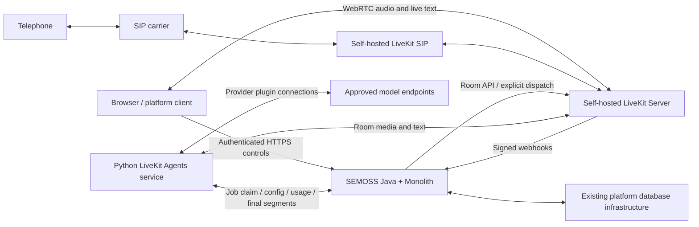

# Replace the platform's Pipecat integration with LiveKit Agents

**Status:** implementation proposal; no application changes made.

**Prepared:** November 17, 2026.

**Deployment baseline:** self-hosted LiveKit, confirmed by the platform owner.

## 1. Decision and intended result

Replace the existing Java-to-Python Pipecat launch mechanism with a dedicated **Python LiveKit Agents service**. Keep **Java/SEMOSS as the authority for users, room membership, model configuration, credentials, tools, persistence, and usage limits**. Connect browsers and phone participants to self-hosted LiveKit for media transport.

“LiveKit only” means one realtime transport and agent framework. It does not mean moving the platform to Python, replacing SEMOSS's model catalog, or requiring LiveKit Cloud. Model providers remain configurable: the open source framework can call commercial APIs or approved self-hosted model endpoints. Running the transport ourselves does not make a commercial model local or free.

The completed replacement provides:

- Multi-person audio rooms with speaker-attributed live captions.
- Translated captions, followed by optional translated speech, with source text retained separately.
- A conversational audio assistant using either a native realtime model or an STT → LLM → TTS pipeline.
- Browser and SIP participants using the same session, permissions, usage, and transcript contracts.
- Reliable start, reconnect, leave, end, cleanup, and failure behavior.
- A documented, tested way to deploy and operate the entire realtime stack without a LiveKit Cloud dependency.

Python is the recommended worker language because the existing audio integration is Python and LiveKit supplies the relevant Python agent APIs and examples. Java uses the official [Kotlin/Java server SDK](https://github.com/livekit/server-sdk-kotlin) for tokens, room administration, and dispatch. The current documented agent implementations are Python and Node.js; a Java server SDK is not a Java Agents runtime. See the [Agents references](https://docs.livekit.io/reference/agents/agent-dispatch-service-api/).

### Scope boundaries

Multi-person captions and translation are first-class requirements. Conversational assistance initially addresses one explicitly selected participant at a time, including in a shared room. Other participants can continue receiving captions and can take the assistant's speaking turn through an authorized control. A free-form group assistant that arbitrates overlapping speakers is a separate behavior milestone, not something obtained by mixing everyone into one input stream.

Keep existing file/clip transcription and TTS working. Do not introduce a general workflow engine, a second realtime framework, a new frontend component package, a replacement model catalog, or recording infrastructure for this migration. Recording and free-form group conversation can be added when specifically needed.

## 2. What exists and what must change

The review covered the SEMOSS backend, Monolith HTTP integration, the SemossWeb frontend source checkout, and the checked-in Audio Center project assets. It did not establish which unpublished external apps or deployed recipes use the existing reactor; that inventory is a release gate.

| Existing surface | Finding | Planned disposition |
|---|---|---|
| [LiveKitController.java][controller] | Creates rooms and tokens, extracts model secrets, generates Python source, launches listeners, and polls for `python-listener`. Joining an existing room can start another listener with the same identity. | Rewrite around room administration and explicit dispatch. Move application lifecycle into a session service. Delete Python source generation, secret interpolation, listener tokens, and synchronous listener polling. |
| [LiveKitJoinRoomReactor.java][join-reactor] | Checks model visibility but does not establish a durable meeting membership policy. Returns `jwt`, `room_id`, and `insightId`. | Temporarily delegate to the new service for verified legacy consumers; otherwise retire with the old API. No unrestricted joins by guessed room name. |
| [lk_to_pcat.py][pipecat] | Mixes transport, providers, translation, and lifecycle in one file. Mutates transcript frames during translation, logs a parameter map containing credentials, and does not establish reliable per-speaker processing. | Delete after replacement gates pass. Do not port the Pipecat frame graph. |
| [lk_listener.py][raw-listener] and [openai_realtime.py][raw-openai] | Maintain custom loops, PCM buffering, and a raw provider WebSocket. Participant audio is not kept as independent conversation streams; results are primarily logged. | Delete, including callers and dependency remnants. Let the supported LiveKit provider plugins own provider protocol details. |
| Operation dispatch in [LiveKitController.java][controller] | `turn_based_translation` is marked as requiring a realtime model. The raw `real_time_transcription` branch is absent from the normal operation registry. | Replace string-driven branching with validated capability combinations. Treat the raw branch as dormant code, not a proven working compatibility contract. |
| [Shared Python dependencies][python-deps] | Contains `livekit>=1.0.17` and `websocket-client>=1.9.0`; does not declare the Pipecat package used by the old file. | Give the new service an independent dependency lock. Remove shared dependencies only after a complete import/caller search. |
| [Backend Maven dependencies][backend-pom] | Uses `io.livekit:livekit-server:0.10.1`. | Upgrade to an exact, tested server SDK version that supports dispatch and webhook verification. |
| [AdminLiveKitListRoomsReactor.java][admin-rooms] | Existing administrative entry point. | Preserve its admin authorization and delegate to the new LiveKit client; add useful session correlation without exposing credentials. |
| [Audio Center HomePage][audio-center-home] and [STTCard][audio-center-stt] | The checked UI records clips and runs batch transcription/TTS. It has no active LiveKit room client. It uses React 18 and an older SDK release. | Preserve batch workflows. Add a source-controlled realtime feature in the main client; optionally link Audio Center to it. Do not make a project-UUID asset tree the owner of platform realtime code. |
| [Platform SDK][sdk-index] | Shared request/session infrastructure; core package has no runtime dependencies. | Add typed control API helpers only. Keep `livekit-client` out of core SDK dependencies. |
| [Existing audio model client][batch-audio] | Batch STT/TTS remains useful independently of realtime. | Keep. Removing Pipecat must not remove file-based model functionality. |

The architecture should eliminate these failure mechanisms rather than reproduce them in renamed files. In particular, presence in a room is not proof that an STT or realtime model stream is ready.

## 3. Target architecture and ownership

| Component | Owns | Does not own |
|---|---|---|
| SEMOSS Java | Authentication, membership, engine authorization, session policy, worker admission, reservations/settlement, retained transcript authorization, allowed tool effects. | PCM buffering, codec negotiation, model WebSocket protocols. |
| Monolith | Authenticated browser endpoints, a narrowly authenticated worker endpoint surface, signed LiveKit webhook receiver. | A second copy of session business logic. |
| LiveKit Server | Rooms, signaling, media transport, tracks, realtime data delivery. | Durable SEMOSS meeting history or SEMOSS access policy. |
| Python worker | Agent lifecycle, per-participant processing, model plugins, turn handling, translation routing, usage observations, transcript callbacks. | User provisioning, arbitrary engine selection, access policy, unrestricted Pixel execution. |
| Frontend | Device controls, participation, transcript rendering, selected language, honest connection and processing state. | Provider credentials or authoritative permissions. |

### Deployment units

Create an independently deployable Python subproject at the proposed path `Semoss/services/voice-agent/`, with its own `pyproject.toml`, generated `uv.lock`, tests, container image, and README. Keep the application package small: entry point, room/session lifecycle, approved provider construction, caption/translation processing, and the SEMOSS control client. Split modules when there is an actual ownership boundary; do not create a generic provider framework above LiveKit.

Use one explicit room job per active media session. The job may own several per-participant agent sessions or STT streams. A room job is not a single combined speaker stream. Worker concurrency limits must account for participants, active languages, and provider connections, not only room count.

The baseline deployment comprises LiveKit Server, the Agents service, and the existing Java services. Add Redis as required by the chosen distributed LiveKit/SIP topology; use the platform's existing database and usage infrastructure for application state. SIP is a separate optional service until the telephony phase. Egress/recording is not required.

Use direct provider plugins with SEMOSS-managed credentials. Cloud Inference, Cloud deployment, Cloud automatic recovery, enhanced Cloud services, and Cloud observability are not baseline dependencies. LiveKit documents [self-hosted Agents support and differences from Cloud](https://docs.livekit.io/transport/self-hosting/).

## 4. Product modes and model selection

Treat these as three processing modes behind one session API, not three unrelated stacks.

| Mode | Processing | Output and behavior |
|---|---|---|
| `captions` | Independent streaming STT for each authorized source participant/track. | Interim and final source-language captions. No assistant speech. |
| `translation` | The same source STT, then translation for each requested target language; optional TTS. | Original captions, translated captions linked to the original segment, optional language audio tracks. No unsolicited conversational answers. |
| `assistant` | A native realtime model, or streaming STT → text model → TTS for the selected participant. | Conversational response audio and text, interruptions, authorized tools. Meeting captions can remain active independently. |

### Provider contract

Replace the single `REALTIME` switch as the sole decision mechanism with a small capability description attached to approved model configuration: `stt`, `translation`, `tts`, `realtime`, and streaming support where relevant. Keep the existing engine IDs, permissions, secret storage, and administrative model configuration patterns. Existing `REALTIME` values can feed a one-time compatibility mapping, but must not imply support for every audio operation.

The resolved session configuration contains engine IDs for the roles actually used, the exact provider/model/endpoint configuration version, allowed languages and voices, and validated generation options. A realtime assistant uses a realtime engine; a cascade uses separate role bindings. Translation does not inherently require a speech-to-speech model. Preserve model identifier case and validate endpoint/provider-specific fields.

Initial implementation choices:

- **Captions:** qualify one direct streaming STT plugin first. Deepgram is the proposed first integration if the current catalog has no suitable streaming engine; adding its SEMOSS capability/configuration and usage pricing is part of that work. Its [direct plugin supports provider-managed credentials and billing](https://docs.livekit.io/agents/models/stt/deepgram/). OpenAI's existing batch STT path remains available, but is not accepted as continuous captioning merely because it is wrapped in a realtime room.
- **Translation:** preserve the existing Amazon Translate option through a small translation function outside Pipecat, using SEMOSS-managed configuration. Also support an existing authorized text model when that is the selected deployment's translation engine. Treat recognized speech as data to translate, not instructions to execute. Implement only the selected production provider first; do not add every possible plugin.
- **Assistant:** qualify the OpenAI realtime plugin against an existing approved engine first. Add a cascade using the selected STT, existing text engine, and approved TTS when independent transcripts, model choice, or tool orchestration require it. An Azure engine requires Azure-specific endpoint/authentication verification; an OpenAI-shaped configuration is not sufficient evidence of compatibility.
- **Translated speech:** use the selected TTS plugin after translated captions pass evaluation. Dedicated speech translation APIs are an optional experiment: LiveKit's current [TranslationSession is under a beta namespace](https://docs.livekit.io/reference/python/livekit/agents/beta/translation/index.html). Do not make that beta API the only production path.

“Configured” and “qualified for production” are distinct. Maintain a short checked-in compatibility table containing provider, engine capability, language, usage units, tested model/version, and result. Reject unsupported combinations before creating a paid stream. Providers and model IDs are deployment configuration, not browser-supplied arbitrary URLs or Python module names.

## 5. Java control service, identities, and durable state

### Service structure

Keep LiveKit-related Java code under the existing `prerna.livekit` package. Introduce a `VoiceSessionService` as the common entry point for HTTP endpoints and any temporary reactors. Rewrite `LiveKitController` into a focused server SDK client, or rename it to `LiveKitClient` and update every caller. Add a small session store and model resolver where needed. Reuse existing authorization and usage helpers rather than copying their logic into this package.

Never use a request's Insight Python interpreter as the owner of a long-lived call. A user can navigate away, an Insight can expire, and a web request can finish without terminating the dedicated room job.

### Separate the identities

Maintain distinct values for:

1. **SEMOSS principal:** the complete `(userId, loginType)` pair. This applies to owners, members, access checks, persistence, usage, and tool actions.
2. **Voice session ID:** stable application identifier, generated server-side.
3. **LiveKit room name:** opaque, server-generated media destination for the current room generation.
4. **Participant connection identity:** opaque and unique per tab/device/call, mapped server-side to the logical speaker and current member. Reuse it for the same connection's normal reconnect, not for a different tab.
5. **Worker identity and generation:** one authoritative processing owner at a time, distinct from every human/SIP identity.

Do not put email addresses, credentials, prompts, or raw engine configuration into room names or public participant attributes. Speaker display names can be deliberately exposed to authorized room participants. A SIP caller is not authenticated as a SEMOSS account merely because a phone number matches an account field.

### Minimal persistent model

Add voice-owned records using the platform's existing database migration/initialization conventions. Use the model inference database as the proposed owner of session/transcript records, with a separate voice namespace; confirm its availability for every target deployment in phase 0. Do not introduce a new database product.

| Proposed record | Required contents |
|---|---|
| `VOICE_SESSION` | ID, owner ID/type, optional project/app association, cost principal, mode, validated configuration/version, retention policy, status/version, physical room name/generation, dispatch/job binding, lease deadline, timestamps, bounded failure reason, creation idempotency key. No provider secrets. |
| `VOICE_SESSION_MEMBER` | Session, principal ID/type or explicitly provisioned external caller binding, role, join status, allowed publication/subscription policy, language choice, revocation time. Connection records map tabs/calls to the member. |
| `VOICE_SEGMENT` | Session/generation, logical speaker, connection/track reference, stable source segment ID, kind, language, source-segment relation, revision, text, finality, timestamps, ordering cursor. Persist final segments only by default. |
| Usage receipt identity | Durable unique receipt IDs and settlement status tied to the existing model usage records/reservations. Extend existing persistence if it supports this; otherwise add the smallest receipt table needed for deduplication and reconciliation. |

Apply database uniqueness/CAS constraints to creation idempotency, current worker claims, and receipt/segment identities. A Java `synchronized` block is not sufficient across multiple SEMOSS instances.

The existing [RoomUtils][chat-rooms] and [RoomMessageStore][chat-messages] own model/chat conversations. [WorkRoomUtils][work-rooms] tracks a user's open collaboration tabs. Neither already provides a multi-person meeting membership model. Keep voice session IDs separate from these IDs. If an assistant belongs to a chat room, store an explicit authorized association and append selected final conversation messages through the existing message store; do not write every caption into chat history or grant meeting members automatic access to a private chat.

### Session lifecycle

Use `starting → active → ending → ended`, with `degraded` and `failed` states where appropriate. Keep media connectivity, processor readiness, and persistence/usage health separately observable. Store a version so stale events cannot undo a newer transition.

Creation and joining proceed as follows:

1. Authenticate the caller; validate the complete principal, project/app access, requested member policy, model capabilities, limits, and retention setting.
2. Persist an idempotent session intent and admission reservation before starting paid processing.
3. Create or reconcile the opaque LiveKit room and explicitly dispatch the named worker. A named agent uses explicit dispatch; do not simultaneously enable automatic dispatch. [LiveKit dispatch documentation](https://docs.livekit.io/agents/server/agent-dispatch/).
4. Return the session ID and `starting` status promptly. Issue room-scoped browser join credentials through the separate join operation. Do not block the web request for the old 40-second listener poll.
5. The worker claims the expected job/generation through SEMOSS, receives scoped configuration, prepares providers, and reports actual readiness. It opens per-speaker processing as eligible tracks appear.
6. A second browser join only adds a participant. It does not dispatch another room worker.
7. Ending cancels model input/output, closes provider sessions, flushes bounded final callbacks, settles/reconciles usage, releases reservations, and closes the room. The operation is idempotent.

External dispatch calls and a database transaction cannot be atomic. If a timeout leaves dispatch outcome unknown, list/reconcile existing dispatches before creating another. Permit only one current worker claim; a duplicate job must close without creating paid model connections. On takeover, revoke the previous generation and stop its media/model activity before declaring the replacement active. Do not claim exactly-once external provider requests when a network failure makes their outcome unknowable.

Use worker leases/heartbeats and a small reconciler over nonterminal sessions to recover abandoned starts and detect orphan rooms/jobs. A worker must stop paid processing when it cannot renew its lease within the configured bounded grace period. Reject stale generation control/content callbacks; late accounting receipts for previously authorized work follow the settlement exception below. Test crash recovery on self-hosted versions: the dispatch API's documented `restart_policy` is [Cloud-only](https://docs.livekit.io/reference/agents/agent-dispatch-service-api/).

## 6. API and trust contracts

The names below are proposed SEMOSS APIs, not claims about existing endpoints or LiveKit SDK signatures. Freeze them in an OpenAPI/JSON contract with fixtures before implementing both ends. Business logic stays in the shared Java service so reactors and HTTP endpoints cannot develop different access rules.

### Browser controls

Expose the following under the existing authenticated Monolith `/api` surface, using its session, CSRF, and error conventions:

| Proposed operation | Semantics |
|---|---|
| `POST /api/voice/sessions` | Create from approved engine IDs, mode, language/retention choices, and an idempotency key. Server resolves owner, cost policy, membership, and room name. |
| `GET /api/voice/sessions/{id}` | Return authorized status, capabilities, members, current generation, and nonsecret configuration summary. |
| `POST /api/voice/sessions/{id}/join` | Recheck membership and issue a short-lived room-scoped token for a connection ID. Return `sessionId`, `roomName`, `participantIdentity`, `serverUrl`, `token`, expiry, and generation. |
| `PUT/DELETE /api/voice/sessions/{id}/members/{memberId}` | Owner/admin membership management with full principal identity and explicit role. Removal uses the self-hosted revocation procedure below. |
| `PATCH /api/voice/sessions/{id}/preferences` | Validate the caller's language/output preference; apply caps and any new model usage admission. |
| `POST /api/voice/sessions/{id}/assistant-turn` | Select/release the authorized participant currently addressing the assistant. Deny conflicts explicitly. |
| `POST /api/voice/sessions/{id}/leave` | Release this connection; leaving is distinct from ending the meeting. Unexpected disconnect is reconciled as well. |
| `POST /api/voice/sessions/{id}/end` | Authorized owner/admin ends the complete session. |
| `GET /api/voice/sessions/{id}/segments?after=...` | Authorized, bounded, cursor-based final history and gap recovery. |

Use explicit errors for forbidden membership/model access, invalid capability combinations, exhausted quota, unavailable capacity, and failed processing. Never return provider secrets. Set join responses to no-store; keep tokens in memory rather than URLs or local storage. Rate-limit creation/join and constrain participants, session duration, active target languages, and simultaneous sessions.

Browser tokens allow only the current room and necessary media/data actions; no room administration, agent grants, or wildcard room access. Enforce observer/speaker roles in grants and server updates, not just disabled UI buttons. Authorized members may see the room's approved language outputs; client-side language selection is a convenience, not language-based confidentiality.

### Worker authentication and credential delivery

Create a dedicated narrow worker surface, proposed `/voice-worker/*`, with its own authentication. The current [UserAccessKeyFilter][auth-filter] treats ordinary Bearer authentication as configured user OAuth and Basic authentication as SEMOSS user access keys. Do not send a new job JWT into that flow and assume it authenticates correctly.

The initial mechanism is a deployment-specific, high-entropy service credential supplied through the deployment secret manager, accepted only over TLS on the dedicated route and compared securely. It permits job claims for that deployment, not general SEMOSS user APIs or arbitrary engine reads. Store its verifier/configuration securely and support rotation. Follow Monolith's existing [dedicated application registration pattern][dedicated-app], with explicit authentication tests; do not exempt the existing `/api/*` surface from authentication.

After verifying the current dispatched job, session, deployment, and generation against server-side dispatch state, the claim operation issues a short-lived opaque job credential. A self-reported job ID alone is insufficient. Subsequent configuration, heartbeat, segment, usage, and scoped tool requests require that credential and the matching job binding. Its expiry/renewal follows the lease. Metadata passed through LiveKit contains only nonsecret session/generation references. Use standard random tokens and hashed server-side storage, not custom cryptography.

Provider configuration is fetched only after admission and retained only in worker memory. Secrets never enter browser responses, dispatch metadata, room attributes, transcript events, command lines, generated source, or logs. A worker is trusted to access credentials for its assigned sessions; this service boundary reduces exposure but does not make a compromised worker harmless. Separate worker deployments/credentials where model trust or tenancy requires it.

Do not store a single unlimited service user's identity as the cost or permission principal. Every action remains associated with the session's authorized principal and, where applicable, the actual speaker initiating a tool.

### Webhooks and reconciliation

Expose a separate signed webhook receiver, proposed `/livekit-webhook/events`. Verify the exact raw body and authorization header with the official Java server SDK before parsing/acting; limit body size, deduplicate event IDs, and reject events for unrelated rooms. Acknowledge only after the event is durably accepted or its idempotent state update completes.

Webhooks assist lifecycle tracking but cannot be the sole source of cleanup or accounting: LiveKit [retries delivery but does not guarantee it](https://docs.livekit.io/intro/basics/rooms-participants-tracks/webhooks-events/). Reconcile current room/participant/dispatch state with the database and worker leases. Out-of-order or duplicate callbacks must not reopen ended sessions.

### Immediate removal on self-hosted LiveKit

LiveKit's documented automatic token revocation is Cloud-only. On self-hosted servers, removing a participant does not invalidate that participant's existing token. Token expiry also does not end an already connected session, and connected clients receive refreshed tokens. Short initial TTLs help but are not an immediate revocation mechanism. [Token lifecycle and self-hosting limitations](https://docs.livekit.io/frontends/reference/tokens-grants/).

For an access removal requiring immediate protection of future media, rotate the physical room:

1. Mark the member revoked and begin a new session generation atomically; stop issuing old-room credentials.
2. Pause/terminate the old worker's processing and disconnect the old room's participants; reject old-generation writes and model admission.
3. Generate a fresh opaque room name, dispatch the current authorized configuration, and let remaining members reconnect through authenticated SEMOSS controls.
4. Keep the logical voice session and authorized history stable. Do not reuse the old physical room name. Replayed old tokens must never reach new meeting audio or trigger a new worker.

This causes a visible reconnect. Report removal as complete only when the old media path has been shut down; fail closed if that cannot be confirmed. A stale token may still access or recreate an empty old room until it expires, so reconciliation must not treat that as permission to resume processing. Test this explicitly. Ordinary voluntary leaving does not rotate the meeting.

## 7. Audio, captions, translation, and assistant behavior

### Per-participant lifecycle

Start from the supported LiveKit room/job lifecycle. Register handlers and enumerate participants already present without creating duplicate sessions when an event races the enumeration. Bind one source processing context to each approved microphone track; replace it cleanly on republish/reconnect. Ignore the worker's own tracks, translated audio, unauthorized publications, and screen-share audio unless explicitly enabled.

LiveKit's [multi-user transcription example](https://github.com/livekit/agents/blob/main/examples/other/transcription/multi-user-transcriber.py) demonstrates independent participant sessions. Adapt that ownership pattern with direct provider plugins and our authorization/usage contracts. Do not copy Cloud Inference defaults into the self-hosted service or rely on private underscored SDK classes from examples.

Track identity supplies attribution for distinct microphones. Several people around one microphone remain one source unless an explicitly qualified diarization mode supplies additional labels. Do not display those inferred labels as verified user identities.

Let the SDK/plugin handle codec conversion and required sample rates. Do not preserve the old fixed PCM chunk sizes, manual WebSocket commit schedule, or independent transport loops. Use async clients inside their owning process/event loop; offload unavoidable blocking translation calls with bounded concurrency. Prewarm safe expensive resources such as local VAD through the framework's supported process lifecycle, and verify the active session actually receives the prewarmed resource.

### Transcript protocol and durable history

Use current LiveKit text streams for native transcription delivery. The documented `lk.transcription` format carries segment and track information; interim and final streams can refer to the same segment. The older `TranscriptionReceived` path is deprecated. Bind adapters to the exact pinned SDK behavior, including finality and segment attributes. [Text and transcription documentation](https://docs.livekit.io/agents/multimodality/text/).

Define one application-level segment contract with:

- `schemaVersion`, `sessionId`, room/worker generation, stable source segment ID, revision.
- Logical speaker ID, connection identity, track reference, source/target language.
- `kind`: source transcription, translation, or assistant output; original segment reference for a translation.
- Text, finality, available start/end times, and a server-assigned history cursor for retained finals.

Map native source captions into that contract at a small boundary. Use an application text topic for translations if native transcription attributes cannot express the relationship through public APIs. Do not publish a second copy of every native caption solely to fit our wrapper. The browser accepts authoritative caption/translation messages only from the verified current worker; a participant's data messages are untrusted content.

Render interim updates in place. Replace the same segment on finalization/revision; never append every delta as another message. Preserve original and translated text separately. Server persistence deduplicates retries and rejects old-generation writers. Use a bounded callback queue with explicit errors/backpressure; if final history cannot be saved, show the gap/degraded state rather than claim a complete transcript. Interim captions may be discarded under pressure; final losses must be visible.

LiveKit text streams are not durable history, and participants joining after a stream starts do not receive it. Fetch authorized retained segments on join/reconnect, then merge live streams by segment identity and cursor. For no-retention sessions, clearly state that earlier text cannot be recovered. [Text stream delivery and persistence](https://docs.livekit.io/transport/data/text-streams/).

### Translation routing

Transcribe a source once. Translate a stable clause/final segment once per distinct requested target language and share that result with listeners choosing that language. Cap target languages and cancel unused pipelines after a short idle period. Never resubmit every interim hypothesis to a paid translator.

Translated audio is published on identifiable language output tracks. Clients subscribe/play the selected translation and original audio according to an explicit user setting; prevent automatic feedback into source STT. Preserve source attribution in associated text. Bound each target language's speech queue: overlapping speakers can produce speech faster than it can be played. Keep captioning live, show delayed audio, and skip stale queued speech according to a documented maximum lag rather than building an unlimited backlog. Do not imply simultaneous overlapping speech can all be heard intelligibly in one translated track.

Changing language takes effect at a segment boundary and starts only after any additional usage admission succeeds. Translation failure should retain original captions and show the unavailable language, not silently substitute an unapproved provider or change the source text.

### Conversational assistant

Use `AgentSession` and the supported model plugin for turn handling, interruptions, output cancellation, and conversation state. Choose a coherent VAD/turn detection strategy per pipeline; do not independently run competing client and server response triggers. Measure barge-in, false interruption, response latency, and truncated playback history.

Greet only when the intended participant and pipeline are ready, if the configured workflow calls for a greeting. A bot joining an empty room must not begin an unrelated conversation. Capture the text actually delivered where interruption support allows it; distinguish model-generated text from audio the user heard.

For shared rooms, the authorized assistant-turn owner supplies the conversational input. Handing the turn to another member rebinds input and verifies that any shared context is appropriate for that member. Do not expose another person's private chat/tool context. Keep independent caption processing for the rest of the meeting when enabled.

Expose only approved SEMOSS tools. Reuse the existing harness and authorization/approval path for effects; do not create a second tool permission system or accept arbitrary Pixel strings from a model. Speech and transcripts cannot approve privileged actions by themselves. Native realtime models that cannot use the required guarded tool path remain conversation-only until that path is tested.

## 8. Usage limits, failure policy, and privacy

### Metering is part of admission, not a later analytics task

Native plugin calls bypass normal Java model invocation. Integrate them deliberately with [ModelUsageGuard][usage-guard], [ModelUsageReport][usage-report], and the existing usage persistence/pricing path. The current report already represents audio token subcounts; they are part of total input/output tokens and must not be charged twice.

1. Resolve the cost principal and every required engine at creation. Default to the initiating user's full identity. A sponsored app/phone session must use an explicitly configured existing app/engine authorization policy and billable principal; the owner cannot silently lend model access merely by inviting someone.
2. For ordinary user rooms, require eligible model access for publishing participants. Listen-only membership does not authorize private tool use. If sponsored usage is needed, implement it through existing app permission rules and test it before admitting external callers.
3. Reserve capacity/usage before opening streams. Continuous sessions need bounded renewable reservations and duration/concurrency ceilings; a single check at join cannot enforce a long call's limits.
4. Attribute provider observations to session, generation, engine, cost principal, source, and a unique provider response or receipt ID. Distinguish cumulative usage snapshots from incremental usage.
5. Settle actual reported usage idempotently, release unused reservations, and reconcile lost responses/worker crashes. Retry delivery of a usage receipt without charging again. Unlike new model work or transcript/control writes, a receipt for previously admitted work may arrive after its generation has ended. Provide a bounded, accounting-only reconciliation path authenticated by the deployment credential and verified against the historical job/reservation; it cannot renew the job or fetch secrets. Never erase incurred usage merely because a lease expired.
6. Stop new input/output when authorization or reservation renewal fails. Define a bounded drain/lease grace, with an explicit user-visible reason. Do not fall back to unmetered operation when Java or the usage store is unreachable.

STT minutes, TTS characters, translation characters, and realtime audio/text tokens are different units. Extend the existing usage reporting/pricing path for the selected provider's real units; do not invent token counts to fit the current API. Configure audio prices explicitly and reject cost-limited sessions when pricing is unknown. Record estimated versus provider-confirmed usage separately. Bound potential overspend from delayed usage reports with reservation windows, maximum response size, maximum duration, and concurrency limits; do not promise an exact dollar cutoff from delayed provider data.

Persist only the minimum settlement detail needed for audit/reconciliation. A final utterance callback and a session-total metric must not both bill the same usage. Language fan-out and duplicated STT for an assistant/caption combination must be visible in usage and avoided where the selected SDK pipeline can share input processing safely.

### Failure behavior

| Failure | Required behavior |
|---|---|
| STT/model unavailable during startup | Mark processing failed; release reservation and clean up. Do not show “captions ready” because the worker participant joined. |
| One translation language fails | Keep source captions and healthy languages; expose that language's failure and bounded retry. |
| Worker crashes | Mark degraded, fence the old generation, reconcile actual dispatch state, then restart within a bounded retry budget. Show any lost transcript/audio interval. |
| Browser network drop | Let normal RTC reconnect run; refresh application status/history and authorization when a new join is needed. No second room worker. |
| SEMOSS/usage service unavailable | Existing work stops by the lease deadline; deny new paid work. Surface the interruption. |
| Persistence queue saturated | Bound memory, stop or degrade the retained-transcript feature visibly, and never report a complete saved transcript. |
| End/cleanup callback lost | Reconciler closes orphan resources and reconciles unresolved reservations. |
| Provider switch requested | Reauthorize and validate the replacement; start a new processing generation. No silent cross-provider fallback. |

### Privacy defaults

Raw audio recording is off. Transcript retention is an explicit session policy selected from administrator-approved options, disclosed in the join UI; default to no durable transcript until a deployment retention policy is configured. A no-retention session still keeps minimal noncontent lifecycle and usage records. Retention/deletion jobs must remove associated translations and exports as well as source text.

Keep provider keys, access tokens, prompts, audio, and transcript text out of routine logs. Include session/job correlation IDs and redacted error categories. Browser/server transport encryption does not prevent the worker and selected model provider from processing the audio; the UI should identify the processing policy without exposing internal implementation detail. Do not enable Cloud observability or recording exports as part of self-hosted setup.

## 9. Frontend and SDK work

Add typed voice control functions and DTOs through the existing SDK request utilities at the proposed `libs/sdk/src/api/voice.ts`, with exports and boundary tests. Reuse the SDK's session, auth headers, CSRF handling, and normalized errors. Do not add the LiveKit browser runtime or React UI dependencies to the core SDK.

Implement the first realtime UI in the main client's proposed `packages/client/src/features/voice/`, exposed by a lazy route using the existing routing conventions. Install `livekit-client` in the owning app and, only if useful for the actual implementation, the official React hooks compatible with its React version. Use existing `@semoss/ui/next`, i18n, session hooks, and `StoreState` conventions. Avoid a new global state framework or an unrelated redesign of existing chat pages.

Required UI states and controls:

- Create/join with an authorized mode/model selection and retention notice.
- Microphone permission, input/output device choice, mute, leave, and owner-only end.
- Participant list with stable speaker labels and observer/speaker state.
- Original captions and selectable translated captions; optional translated audio control.
- Distinct “connecting to room,” “starting captions/assistant,” “ready,” “reconnecting,” “degraded,” and “ended” states.
- Language/provider/limit failure explanations and recoverable retry where appropriate.
- Assistant-turn selection and an explicit indication of whom the assistant is listening to.
- A visible recording/retention policy, even when recording is disabled.

Own the room connection, handlers, microphone tracks, audio playback, and cancellation in one lifecycle hook/controller. Cleanup must work on leave, route change, logout, failed join, permission denial, and React Strict Mode remount. No microphone may remain live after the owning feature closes. Handle browser autoplay restrictions with an explicit user gesture.

Captions need keyboard-accessible controls, readable speaker/language labels, and restrained screen-reader announcements. Do not send every interim token into an assertive live region. Test narrow screens and long translations. UI language choice must not imply audio-language support that the provider has not qualified.

The existing Audio Center is a separate React 18 app. Keep its batch functionality. The first integration can simply link to the new realtime route; embedding later uses the public SDK contract and compatible LiveKit client, not an import of the private React 19 `@semoss/shared` package. Promote shared connection code into an existing compatible package only when there is a second actual consumer.

## 10. Operations and deployment

### Reproducible local and production setup

Provide a local compose example and production deployment instructions with pinned image/dependency versions, explicit configuration, health/readiness probes, and a two-client smoke test. Local development may use local-only credentials; production must use deployment secrets and TLS. Load required VAD/turn-model assets into the image or a controlled cache rather than downloading them unpredictably on the first call.

Expose separate public client and internal control URLs when required. Configure TLS certificates, reverse-proxy WebSocket support, WebRTC ICE transport, and TURN fallback. Document the chosen UDP/TCP/TURN port topology, including load balancers and NAT; an HTTP health check alone does not validate media connectivity. Use LiveKit's [deployment guide](https://docs.livekit.io/transport/self-hosting/deployment/) and [ports/firewall reference](https://docs.livekit.io/transport/self-hosting/ports-firewall/).

Suggested configuration groups: LiveKit client/control URLs and keys; worker deployment identity and SEMOSS control URL; job admission/lease limits; maximum speakers/languages/duration; provider configuration references; permitted retention policies; logging/metrics destinations. Specify each variable's owner and whether it is a secret in the runbook. Never commit actual values.

### Scaling and lifecycle

- Readiness requires worker registration and required assets/configuration, not merely a running process. Separate component health from paid provider connectivity tests.
- Benchmark CPU, memory, provider sockets, and network for the chosen number of active speakers and target languages. Set worker load limits from measurements, with queue/admission behavior when capacity is exhausted.
- Support graceful drain: stop accepting new jobs, allow active jobs their configured drain budget, then close cleanly. Match container/orchestrator termination grace to that budget. Do not assume a default orchestrator timeout fits a long call.
- Prewarm only process-safe resources; create async HTTP/model clients in the correct worker event loop. Bound background tasks and close them on all exits.
- Deploy workers independently from Java. A Java rolling restart must not spawn duplicate jobs or orphan active leases. State and reservations must work across instances.

The current release reviewed was [LiveKit Agents 1.8.12](https://github.com/livekit/agents/releases/tag/livekit-agents%401.8.12). Treat that as a candidate baseline, then lock a compatible Python, plugin, RTC, server, JVM SDK, and browser SDK set. The JVM SDK's [README fetched for the final check](https://raw.githubusercontent.com/livekit/server-sdk-kotlin/main/README.md) advertises 0.17.0; verify compatibility with SEMOSS's dependency graph instead of blindly replacing the Maven version. Never ship open-ended `>=` ranges for the standalone worker. Test upgrades with the same audio and failure fixtures before rollout.

### Observability and runbooks

Correlate session ID, generation, room/participant/track references, dispatch/job ID, engine, and provider request ID where available. Restrict high-cardinality IDs to logs/traces rather than Prometheus labels.

Measure join latency, processor-ready latency, caption lag/finality, translation lag, assistant response and interruption latency, active jobs/streams, reconnects, provider errors/rate limits, lease failures, transcript queue depth/gaps, and usage settlement lag. Keep contents out of standard telemetry. Export through the existing self-hosted logging/metrics path; do not require the Cloud dashboard.

Document procedures for: no microphone audio, TURN-only connection failure, missing captions despite room presence, exhausted provider quota, worker crash, repeated dispatch, usage receipt backlog, immediate membership revocation, draining a release, and rollback. Include a command/test that proves media and final text crossed the complete deployed path.

## 11. Telephony phase

Deploy LiveKit's self-hosted SIP service alongside the chosen LiveKit topology. Configure an approved carrier trunk and inbound routing; outbound dialing is a separately authorized platform action. No paid number purchase, provider subscription, or outbound call is part of implementing this plan without a selected deployment and authorized test destination.

Use one dispatch owner for SIP as for browsers. Proposed baseline: SIP routing places a caller in an isolated room, then SEMOSS bootstraps a session from a verified signed event plus a server API lookup of the SIP participant and configured trunk/destination policy. It creates or binds the voice session, admits usage, and explicitly dispatches the worker. Do not trust arbitrary participant metadata as proof of SIP origin, or also enable an agent in the SIP dispatch rule. Configure room naming to avoid embedding phone numbers, and reconcile missed inbound events from current server state. Until admission succeeds, the caller has no access to an existing private meeting or model/tool output. Account for a caller arriving before SEMOSS is ready with a bounded admission timeout and clear failure/hangup behavior. LiveKit [SIP dispatch rules](https://docs.livekit.io/telephony/accepting-calls/dispatch-rule/) support room routing and can also configure agents, which is why the ownership choice must be explicit.

External callers require an app-sponsored engine policy and cost principal, rate/concurrency/duration limits, and a configured information-disclosure policy. Caller ID is display/routing data, not authentication. Require an appropriate verification step before any account-specific data or tool access. Allowlisted trunks and the signed server-side event path establish that the call came through the intended integration, not that the caller owns a SEMOSS account.

Validate codec/sample-rate handling, DTMF if the workflow uses it, caller/callee hangup, reconnect/failure behavior, human transfer if required, and final usage settlement. A browser leaving must not accidentally terminate an active caller unless the session policy says it ends the meeting.

## 12. Verification and acceptance gates

The checks below are implementation requirements. None of these runtime checks have been run as part of writing this plan.

### Deterministic tests

| Layer | Required high-value coverage |
|---|---|
| Java/service | Same user ID under different login types; unauthorized joins/history/tool use; role enforcement; engine/app permissions; unknown pricing; quota exhaustion; idempotent create/end; simultaneous joins across service instances; duplicate/unknown dispatch outcomes; stale claims and callbacks; failed lease renewal; durable usage deduplication. |
| Monolith | Existing browser auth/CSRF preserved; worker routes reject user tokens and wrong deployment/job credentials; ordinary APIs reject worker credentials; raw-body webhook verification; expired/replayed/malformed callbacks; request validation and no secret responses. |
| Python | Participants present before startup and joining concurrently; track replacement; cleanup on all failures; independent speaker contexts; no own-audio feedback; translation retains source; bounded translation/audio queues; provider timeout/rate limit; usage units/deduplication; stale generation termination. Mock provider/network boundaries, not the behavior under test. |
| SDK/frontend | Request/response contract and errors; delta/final merge; late history merge; stale generation ignored; spoofed caption sender ignored; permission/autoplay failures; no duplicate room connection or leaked microphone/handler on remount/logout. |
| Database | Additive migration/restart on supported databases; uniqueness under concurrent create/claim/receipt writes; retention deletion; compatibility with the previous deployable application version during rollout. |

### Self-hosted integration tests

Run actual LiveKit Server plus the worker, SEMOSS controls, and at least two automated RTC clients publishing known audio fixtures. Cover overlapping speakers, join/leave/republish, two tabs for one user, muted/listen-only roles, language changes, and a late join. Verify speaker/segment attribution and provider call counts, not only that some text appears.

Use at least two distinct source languages and two translation targets from the supported launch language set. Include names, numbers, silence, background noise, short interjections, and long speech. Measure translation quality with bilingual review on a fixed corpus; require critical names/numbers to remain correct in the agreed cases. Do not treat a single English demo as multilingual qualification.

Kill a worker, interrupt Java connectivity, lose a webhook, duplicate callbacks, saturate a translation queue, exhaust quota, restart a LiveKit node, and exercise TURN/TCP fallback. Verify bounded cleanup and visible gaps. Rejoin with an old token after membership removal and prove it cannot access the new room's audio or history.

For assistants, test multi-turn tool behavior with the LiveKit test harness and scripted providers, then real audio conversations for latency, interruption, recognition, and incorrect tool actions. Text-only simulations do not validate STT, TTS, VAD, or transport. The self-hosted acceptance suite must run without a Cloud simulation subscription; Cloud tooling is optional supplementary evidence.

### Initial performance budgets

These are proposed warm-path budgets for a controlled reference environment, **not measured promises**. Record exact start/end timestamps and network/provider conditions; tune the launch targets after the first vertical slice.

| Measure | Initial target |
|---|---|
| Authenticated join-token API | p95 under 500 ms, excluding login and initial provider warm-up. |
| Worker processing ready after admitted dispatch | p95 under 5 s with warm capacity; cold-start measured separately. |
| First useful streaming caption | p95 under 1 s from the recognizable source phrase in the reference corpus. |
| Translated caption | p95 under 2 s after the source clause is finalized. |
| Assistant first audible response | p95 under 1.5 s after the selected turn endpoint; report endpointing delay separately. |
| Barge-in stop | Target under 300 ms from detected interruption to stopped output; validate over the deployed network. |

Hard gates are stronger than averages: no cross-room access, no cross-speaker attribution caused by shared buffers, no duplicate settled charges from retried callbacks, no worker left running indefinitely after end/lease expiry, no secrets in logs/client payloads, and no silent transcript gaps. Declare the tested concurrent rooms/speakers/languages and machine sizes before making a production capacity claim.

## 13. Implementation sequence and reviewable changes

Each row should become a bounded change or small linked set across repositories. Enable only the modes whose gates have passed. Keep new-session routing behind a deployment/project feature flag; avoid two frameworks processing the same live microphone for comparison.

| Phase | Deliverables | Exit gate |
|---|---|---|
| **0. Baseline and contracts** | Inventory external reactor consumers; freeze browser/worker/segment/usage schemas; choose launch languages, streaming STT engine, retention policy, sponsorship policy, and reference load. Pin candidate SDK versions and capture current test baselines. | Contract fixtures and compatibility inventory reviewed; no unresolved authorization/metering owner. |
| **1. Safe caption vertical slice** | Dedicated locked Python service; local LiveKit setup; Java session service/store and explicit dispatch; browser create/join/status; worker auth/claim/config; real per-speaker captions; admission, bounded limits, cleanup, and minimum usage settlement. | Two clients receive correctly attributed captions; repeated joins create one active worker; end releases all streams; forbidden access and unmetered work are rejected. |
| **2. Complete platform integration** | Typed SDK, source-controlled client UI, membership and immediate removal, retained/no-retention transcript behavior, webhook/reconciliation, complete usage unit/pricing handling, distributed idempotency, legacy adapter if still needed. | Reconnect/history, multiple tabs, quota/crash/replay tests and UI cleanup/accessibility pass. Ready for a restricted internal captions pilot. |
| **3. Translation** | Selected translation engine, source-linked translated captions, target-language accounting/caps, optional TTS tracks and bounded playback. | Agreed language corpus and overlapping-speaker cases pass; source preserved; same-language listeners share work; lag/failure visible. |
| **4. Conversational assistant** | Approved realtime plugin; selected-speaker control; coherent turn handling; retained conversation policy; scoped existing tools; cascade where required. | Real audio interruption tests, usage attribution, private-context isolation, and tool authorization/approval tests pass. |
| **5. SIP** | Self-hosted SIP/carrier configuration, inbound session bootstrap, sponsorship, call identity and lifecycle; authorized outbound integration if requested. | Authorized test calls complete and hang up cleanly; no private access based on caller ID; retry/restart does not double-dispatch or double-charge. |
| **6. Production hardening and canary** | Load/fault tests, TURN validation, dashboards, alerts, drain/rollback runbooks, version matrix, packaging/release notes. Canary by project/deployment. | Measured capacity and latency accepted; no orphan jobs or unexplained settlement backlog; rollback rehearsed. |
| **7. Cutover and deletion** | Route supported new sessions to LiveKit Agents, drain old sessions, remove Pipecat/raw-WebSocket code and retired adapters/configuration/dependencies, update documentation and examples. | Caller search and consumer inventory clear; supported modes and regression suite pass; no production dependency on deleted launch path. |

Phases 0–2 are the critical foundation. Translation and assistant work can follow that shared contract independently; both need real model qualification. SIP uses the same controls and must not invent a separate room/usage subsystem. Calendar estimates should follow the vertical slice and consumer inventory, because network topology, language quality, and continuous-session metering are the significant unknowns.

### File and repository change map

New paths below are proposed, not existing implementations.

| Repository/area | Planned changes |
|---|---|
| SEMOSS `src/prerna/livekit/` | Rewrite/rename controller; add session service/store/model resolution and lifecycle reconciliation. Keep responsibilities small and explicit. |
| SEMOSS `src/prerna/reactor/livekit/` | Temporary compatibility delegation or removal; any new/touched reactors use `getReactorDefinition()` and complete key/output metadata. |
| SEMOSS existing model usage/inference tracking | Add continuous-session admission/settlement and required provider usage units, schema migrations, transcript records, and focused tests. Preserve existing text-model behavior. |
| SEMOSS `services/voice-agent/` | New isolated worker project, provider bindings, contract fixtures, tests, lockfile, container, and operational README. |
| SEMOSS `py/audio/` | Delete the three legacy files and unreferenced exports after cutover. Preserve unrelated batch audio clients. |
| SEMOSS `py/install_config/pyproject.toml` and `pom.xml` | Remove confirmed-unused shared Python dependencies; update/pin JVM SDK. Keep dependencies such as `boto3` if other platform features use them. |
| Monolith services/app registration | Add browser controls through existing auth; dedicated authenticated worker application and signed webhook receiver; minimal `web.xml` registration; service/auth tests and API export. Merge with unrelated local changes carefully. |
| SemossWeb `libs/sdk/src/api/voice.ts`, index, tests | Typed JSON controls using existing transport; no LiveKit runtime dependency in core SDK. |
| SemossWeb `packages/client/src/features/voice/`, routes, package manifest/tests | Realtime room UI and connection lifecycle; owning app's LiveKit dependency; generated lockfile changes. |
| Existing Audio Center | Keep batch UI; optional link to the realtime feature. Any later embedding is a separate consumer migration. |
| Deployment configuration and docs | Versioned local example and production guide in the worker project or established infrastructure owner; CI jobs; feature flags; runbooks; remove stale Pipecat setup instructions. |

During implementation, search every changed public symbol, reactor name, Python import, config key, and dependency across source, tests, fixtures, templates, examples, and external consumer inventory. Do not hand-edit generated bundles, compiled Java output, database files, or vendored dependencies.

## 14. Cutover, compatibility, and rollback

Keep schema changes additive until the previous application version no longer needs to run. Release controls and the worker before enabling the new frontend route. Include a protocol version in worker/browser contracts; reject incompatible jobs clearly rather than failing mid-call.

If real consumers still use `LiveKitJoinRoom`, keep a short-lived adapter that maps the supported legacy operations to the new modes, validates full authorization, and returns the fields those consumers require. `insightId` may remain response context, but it no longer owns the worker. Unknown legacy `roomId` values cannot authorize arbitrary joins. Return migration errors for unsupported parameter-map behavior; never accept caller-supplied secrets or unchecked provider settings for compatibility. If no active consumers exist, deleting the old surface is simpler than maintaining the adapter.

Do not migrate the PCM/socket state of a live old call. Let admitted legacy sessions drain under a bounded deadline while new sessions use the new service. Compare systems with recorded test fixtures and separate test rooms, not by silently duplicating a production user's audio and provider cost.

Rollback affects **new session admission**. First disable the affected mode or route to the last known-good LiveKit Agents release, preserve transcripts/usage receipts, and let healthy active calls drain. The old Pipecat path is not an automatic fallback: re-enabling it requires a specifically qualified legacy configuration, and may be less safe than temporarily disabling new sessions. Rehearse worker/API protocol rollback and database compatibility before canary.

After the observation window agreed for the canary, remove the legacy launch code, raw WebSocket client, obsolete operation mapping, parameter-map credential plumbing, `python-listener` assumptions, legacy polling, unused dependency/configuration entries, and old documentation. Search retained logs according to existing operational policy for prior credential exposure; rotate affected credentials if exposure is confirmed. Do not delete historical user data or unrelated batch audio features as cleanup.

### Definition of complete

- Supported rooms, captions, translation, assistant, and enabled phone workflows run through self-hosted LiveKit and LiveKit Agents.
- SEMOSS permissions, full principal identity, model choice, credential handling, and usage enforcement apply to every provider call.
- The agreed multi-speaker/language corpus, security/concurrency tests, browser cleanup checks, and deployed network/failure tests pass.
- Operators can trace and terminate a session, explain its usage, recover from failure, drain a deploy, and roll back.
- No remaining caller requires the Pipecat/raw-WebSocket launch path, and the retired files/dependencies are removed.

## 15. Remaining deployment choices and evidence limits

The plan has a firm self-hosted baseline. Before each relevant implementation gate, record the actual streaming STT/translation/TTS engines, launch languages, target concurrent speakers/languages, production network topology, retention duration, and SIP carrier/test destinations. Defaults in this proposal allow the core architecture to proceed; these choices determine provider qualification and capacity rather than changing ownership boundaries.

This proposal is based on source inspection and current official LiveKit documentation/examples. The LiveKit documentation CLI returned `Forbidden` during this review, so web documentation and upstream source were used as the fallback. No implementation snippets here have been executed against an SDK. Exact signatures and plugin behavior must be checked against the pinned releases when writing code.

No service was deployed, microphone/phone call run, paid model evaluation performed, or production load measured while preparing this document. The highest-risk implementation work is continuous-session metering, worker/room recovery across failures, hard access removal on self-hosted LiveKit, and multi-speaker translation latency. The first vertical slice is designed to test those boundaries before a broad rewrite.

[controller]: /Users/rweiler/Documents/SEMOSS/workspace/Semoss/src/prerna/livekit/LiveKitController.java
[join-reactor]: /Users/rweiler/Documents/SEMOSS/workspace/Semoss/src/prerna/reactor/livekit/LiveKitJoinRoomReactor.java
[pipecat]: /Users/rweiler/Documents/SEMOSS/workspace/Semoss/py/audio/lk_to_pcat.py
[raw-listener]: /Users/rweiler/Documents/SEMOSS/workspace/Semoss/py/audio/lk_listener.py
[raw-openai]: /Users/rweiler/Documents/SEMOSS/workspace/Semoss/py/audio/openai_realtime.py
[python-deps]: /Users/rweiler/Documents/SEMOSS/workspace/Semoss/py/install_config/pyproject.toml
[backend-pom]: /Users/rweiler/Documents/SEMOSS/workspace/Semoss/pom.xml
[admin-rooms]: /Users/rweiler/Documents/SEMOSS/workspace/Semoss/src/prerna/auth/utils/reactors/admin/AdminLiveKitListRoomsReactor.java
[audio-center-home]: </Users/rweiler/Documents/SEMOSS/workspace/Semoss/project/Audio Center__9bbea6f6-236c-4fc2-9efc-2937d5312935/app_root/version/assets/client/src/pages/HomePage.tsx>
[audio-center-stt]: </Users/rweiler/Documents/SEMOSS/workspace/Semoss/project/Audio Center__9bbea6f6-236c-4fc2-9efc-2937d5312935/app_root/version/assets/client/src/components/stt/STTCard.tsx>
[sdk-index]: /Users/rweiler/Documents/SEMOSS/workspace/apache-tomcat-11.0.24/webapps/SemossWeb/libs/sdk/src/index.ts
[batch-audio]: /Users/rweiler/Documents/SEMOSS/workspace/Semoss/py/genai_client/text_generation/openai_clients/openai_audio_client.py
[chat-rooms]: /Users/rweiler/Documents/SEMOSS/workspace/Semoss/src/prerna/engine/impl/model/RoomUtils.java
[chat-messages]: /Users/rweiler/Documents/SEMOSS/workspace/Semoss/src/prerna/engine/impl/model/RoomMessageStore.java
[work-rooms]: /Users/rweiler/Documents/SEMOSS/workspace/Semoss/src/prerna/collaboration/WorkRoomUtils.java
[auth-filter]: /Users/rweiler/Documents/SEMOSS/workspace/Monolith/src/prerna/web/conf/UserAccessKeyFilter.java
[dedicated-app]: /Users/rweiler/Documents/SEMOSS/workspace/Monolith/src/prerna/semoss/web/app/MicrosoftGraphApplication.java
[usage-guard]: /Users/rweiler/Documents/SEMOSS/workspace/Semoss/src/prerna/engine/impl/model/usage/ModelUsageGuard.java
[usage-report]: /Users/rweiler/Documents/SEMOSS/workspace/Semoss/src/prerna/engine/impl/model/usage/ModelUsageReport.java
